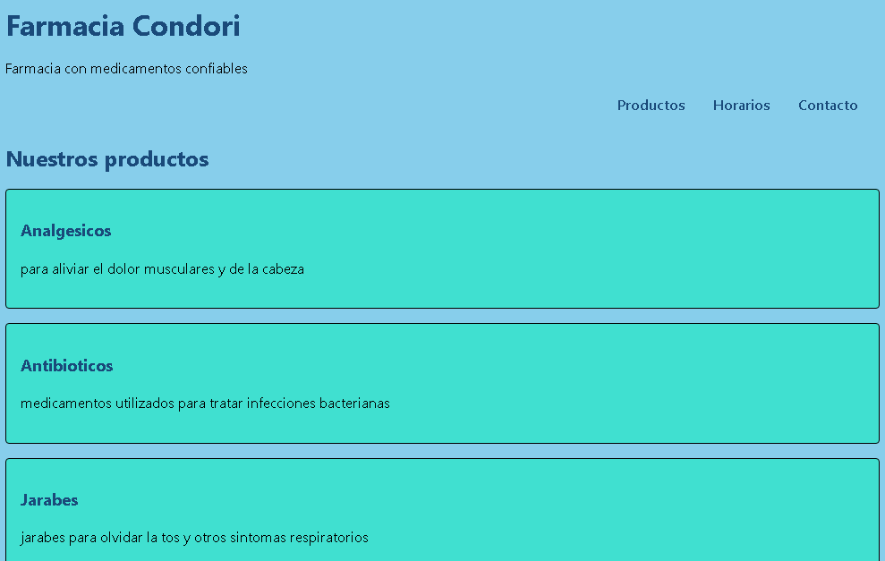

# [farmacia condori]

*Estudiante:* [luis felix condori churqui]
*Cliente:* [farmacia condori]
*URL publicada:* [DESPUES, PROXIMA SEMANA]

## Qué resuelve
[La Farmacia Condori necesita una página web para presentar sus productos y facilitar a los clientes en información sobre medicamentos, horarios de atención y datos de contacto. El sitio permite conocer las categorías de productos disponibles y llenar un formulario para realizar pedidos. De esta manera, los clientes pueden consultar la información de la farmacia de forma sencilla.]

## Cómo está construido
- *Semántica:* [Se utilizaron etiquetas HTML5 como header, nav, main, section, article, aside y footer para organizar el contenido.]
- *Layout:* [Se utilizó una estructura organizada mediante HTML y CSS para distribuir las secciones de la página. Los productos se presentan en bloques individuales mediante la etiqueta article. Se puede incorporar Flexbox para organizar el menú de navegación y Grid para distribuir los productos en columnas, si el diseño lo requiere.]
- *Diseño:* [Se eligió una paleta de colores con fondo azul celeste, bloques turquesa y texto azul oscuro. Estos colores permiten diferenciar las secciones y facilitan la lectura. La tipografía se seleccionó buscando claridad y legibilidad para que los clientes puedan consultar la información fácilmente.]

## Capturas

 DESPUES, PROXIMA SEMANA

## Lo más difícil
[Qué problema técnico te costó más y cómo lo resolviste. Sé específico:
Uno de los problemas técnicos fue conseguir que cada producto apareciera dentro de su propio recuadro turquesa. Al principio, solamente la sección de Analgésicos tenía el fondo y el borde, porque las etiquetas article estaban mal organizadas y algunos productos quedaban fuera de ellas. 
"el menú se salía de la pantalla en móvil y lo resolví con flex-wrap"
vale; "fue difícil pero lo logré" no vale.]

## laboratorio 2:Lo que hicimos estos días (JavaScript, datos, render y eventos)

### Datos (`datos.js`)
Aumentamos un arreglo de objetos llamado `productos`. Cada medicamento tiene su nombre, precio, categoría, stock, disponible, imagen y descripción. También usamos los métodos de arreglos (`map`, `filter`, `find`, `reduce`) para manejar los datos y calcular el inventario de la farmacia.
## funciones (funciones.js)
Practicamos las distintas formas de escribir funciones en JavaScript (declaradas, expresiones y funciones flecha `=>`). Realizamos cálculos de precios, descuentos e impuestos, aprendimos a pasar funciones como argumentos y utilizamos cierres (*closures*) para crear contadores independientes de ventas (`jarabesVendidos` y `vitaminasVendidas`).

### La app (`app.js`)
Trabajamos con constantes (`const`) y variables (`let`) para controlar los datos del negocio y el stock. Conectamos JavaScript con el HTML para mostrar avisos en tiempo real mediante el elemento `<p id="aviso-stock">`.

### El render y lo que nos dificultó (`render.js`)
Creamos la función que genera las tarjetas de los medicamentos en pantalla usando los datos.
- **Lo que nos dificultó:** Al principio no querían salir las tarjetas y salía un error porque en el HTML faltaba el contenedor `<div id="lista-productos">` (decía `El contenedor existe: false`). Nos costó entender que ya no se debían escribir los `<article>` a mano en el HTML, sino dejar que JavaScript los dibuje de forma dinámica.

### Los eventos (`eventos.js`)
- Agregamos el buscador con el evento `input` para filtrar medicamentos según lo que se escribe.
- Pusimos los botones de filtro con el evento `click` para mostrar medicamentos por su categoría.
- Validamos el formulario de pedidos en el evento `submit` evitando que se recargue la página.

### Lo que aumentamos en el index (`index.html`)
- Cambiamos los artículos fijos por el contenedor vacío `<div id="lista-productos"></div>`.
- Aumentamos los controles del buscador y los botones de filtro.
- Aumentamos los scripts al final de la página en su orden de ejecución:
  ```html
  <script src="datos.js"></script>
  <script src="funciones.js"></script>
  <script src="render.js"></script>
  <script src="eventos.js"></script>
  <script src="app.js"></script>
  ```